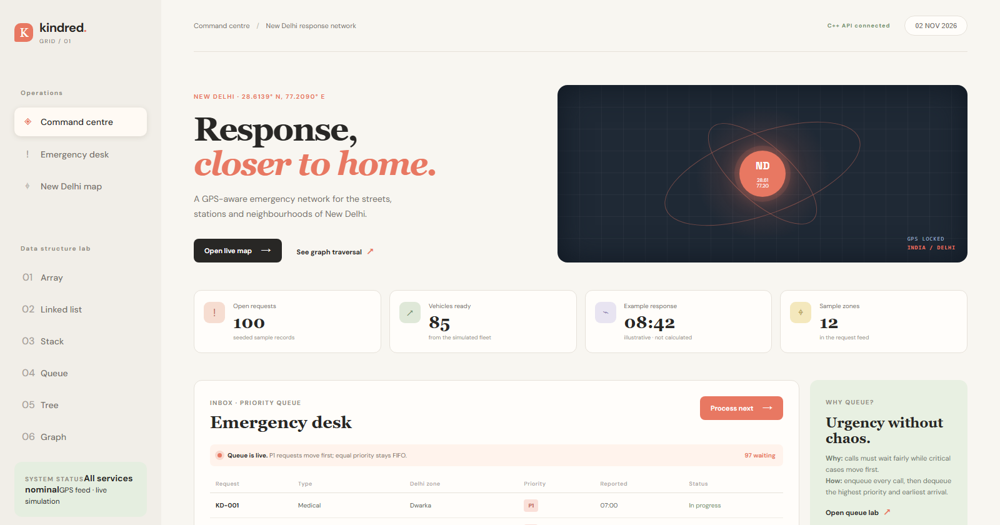
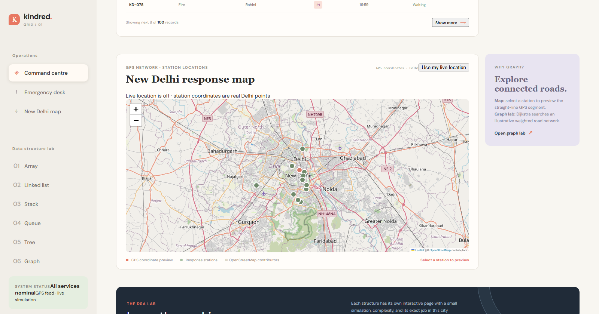
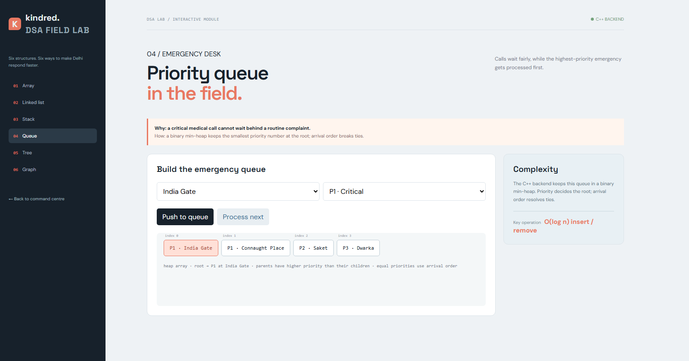
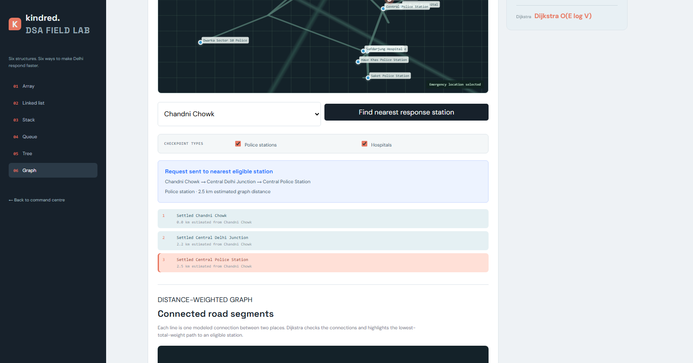
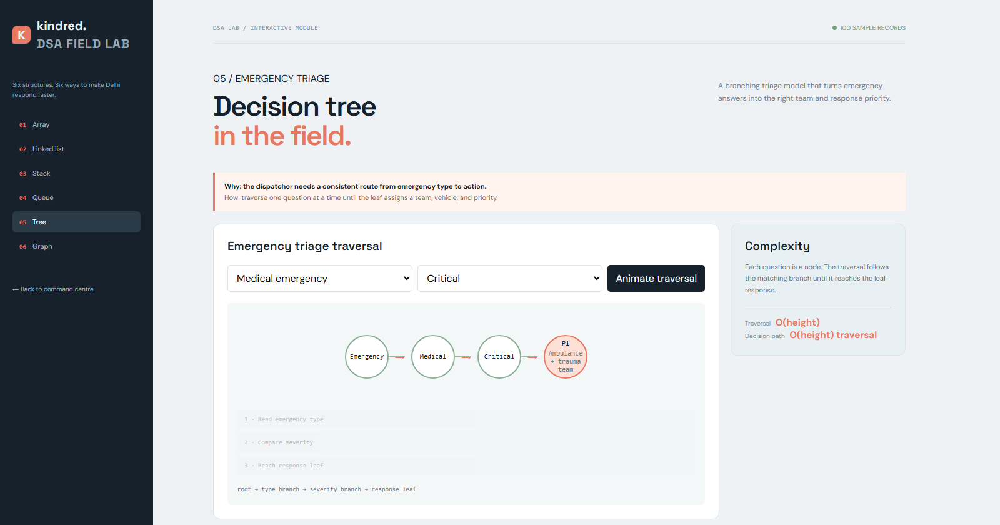
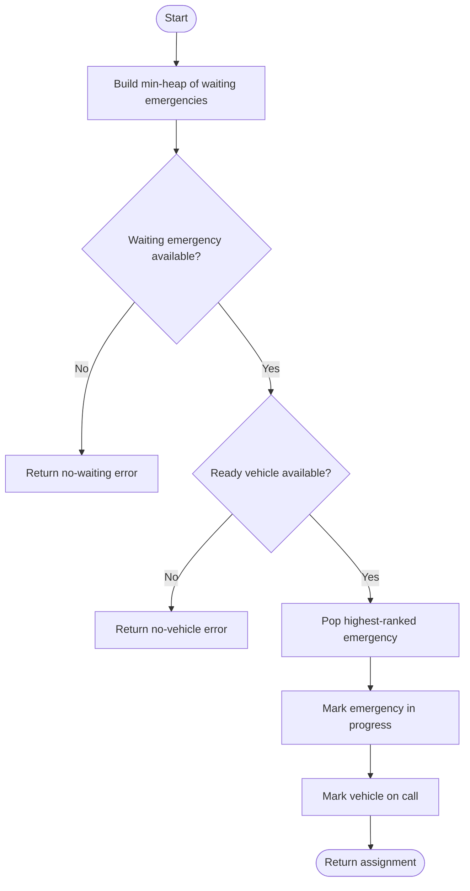
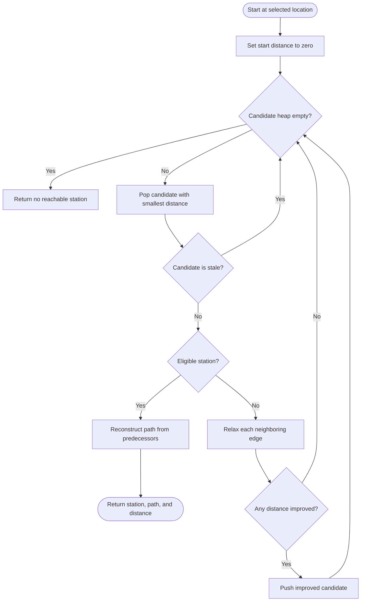

# Kindred City

**A smart-city emergency-response dashboard and data-structures lab for New Delhi.**

Kindred City is an educational web application backed by a small C++17 server. It demonstrates priority-based emergency processing and shortest-path search alongside browser-based visualizations of common data structures. Its records and routes are simulated; it is not a live dispatch system or navigation service.

## At a glance

- **Command centre:** sample emergency, vehicle, and response-station status.
- **Priority queue:** process lower-numbered priorities first; equal-priority queue items retain FIFO order.
- **Graph lab:** find the nearest eligible sample station with Dijkstra’s algorithm.
- **DSA lab:** interactive array, linked-list, stack, queue, tree, and graph demonstrations.
- **Delhi map:** Leaflet and OpenStreetMap tiles, station markers, straight-line previews, and opt-in browser location.

## Screenshots

| Command centre | OpenStreetMap station map |
| --- | --- |
|  |  |

| Priority queue lab | Dijkstra graph route |
| --- | --- |
|  |  |

| Decision-tree lab |
| --- |
|  |

## How the algorithms work

### Emergency assignment

The backend builds a min-heap from waiting emergencies, selects the highest-ranked request, and pairs it with a ready vehicle. Emergency ties use the emergency ID as a deterministic tie-breaker. If no request or vehicle is available, the API returns an error.



### Nearest eligible station

The graph endpoint runs Dijkstra’s algorithm over an illustrative, weighted, undirected graph. Edge weights are estimated distances, not live road or traffic data.



## Run locally

### Requirements

- Windows and PowerShell
- MinGW-w64 with `g++` available on `PATH`
- Internet access for the dashboard’s Leaflet library and OpenStreetMap tiles

From the repository folder, run:

```powershell
.\start-localhost.ps1
```

The script compiles `backend\main.cpp` and serves the site at <http://localhost:8000>. Keep the PowerShell window open while using the app; press **Ctrl+C** to stop the server. No database or third-party C++ library is needed.

To build and launch manually:

```powershell
g++ -std=c++17 -static backend\main.cpp -lws2_32 -o backend\kindred-server.exe
.\backend\kindred-server.exe --root . --port 8000
```

## Pages

| Page | Demonstration |
| --- | --- |
| [Command centre](./index.html) | Emergency dashboard, station map, and optional live-location request |
| [Array](./array.html) | Indexed traffic readings |
| [Linked list](./linked-list.html) | Vehicle nodes and links |
| [Stack](./stack.html) | Route history and last-in, first-out operations |
| [Queue](./queue.html) | Priority queue operations |
| [Tree](./tree.html) | Emergency triage decisions |
| [Graph](./graph.html) | Weighted network traversal and Dijkstra routing |

The dashboard, queue, emergency assignment, and graph operations use the C++ backend. Array, linked-list, stack, and tree pages are browser-side demonstrations.

## Backend API

The local server listens on `127.0.0.1:8000`.

| Method | Path | Purpose |
| --- | --- | --- |
| `GET` | `/api/health` | Check server health |
| `GET` | `/api/dashboard?limit=8` | Get dashboard counts and emergency records |
| `POST` | `/api/emergencies/next` | Assign the next waiting emergency and a ready vehicle |
| `GET` | `/api/queue` | Read the priority queue |
| `POST` | `/api/queue/add?place=Saket&priority=1` | Add a queue item |
| `POST` | `/api/queue/next` | Process the highest-priority queue item |
| `GET` | `/api/route?location=Saket&type=all` | Find the nearest eligible station with Dijkstra’s algorithm |

Sample data is held in memory and resets when the server restarts.

## Map and location

## Map and location

Both the **Command Centre** and the **Graph Lab** use **Leaflet** with interactive tiles. They require internet access for map tiles and Leaflet assets, display OpenStreetMap attribution, and require **no API keys or billing configuration**.

- **Command Centre map**: Displays active emergencies and response stations across Delhi. Selecting an emergency or table row highlights the incident and calculates straight-line distance to the nearest station. Pressing **Process next** triggers a live dispatch route and vehicle animation. Browser geolocation is requested only after pressing **Use my live location**.
- **Graph Lab map**: Renders an interactive weighted road network with hospitals, police stations, junctions, and emergency nodes. Users can click any emergency node or station on the map, filter checkpoint types, and run Dijkstra's algorithm to watch step-by-step vertex exploration, shortest-path calculation, and vehicle dispatch animation.

## Project structure

| Path | Purpose |
| --- | --- |
| `backend/main.cpp` | C++ server, sample data, heap, and graph algorithms |
| `assets/css/` | Dashboard and DSA lab stylesheets |
| `assets/js/` | Dashboard behavior, API client, and DSA lab visualizations |
| `index.html` and the other root-level `*.html` pages | Command centre and DSA lab entry points |
| `start-localhost.ps1` | Windows build-and-run script |
| `docs/images/` | README screenshots |
| `report/` | Project reports |

## Scope and limitations

- Emergency, vehicle, and station data are simulated; no real emergency services are contacted.
- The graph uses illustrative connections and estimated distances, not live road or traffic data.
- The dashboard map’s line is a straight-line coordinate preview, not a driving route.
- The displayed average response time is illustrative.
